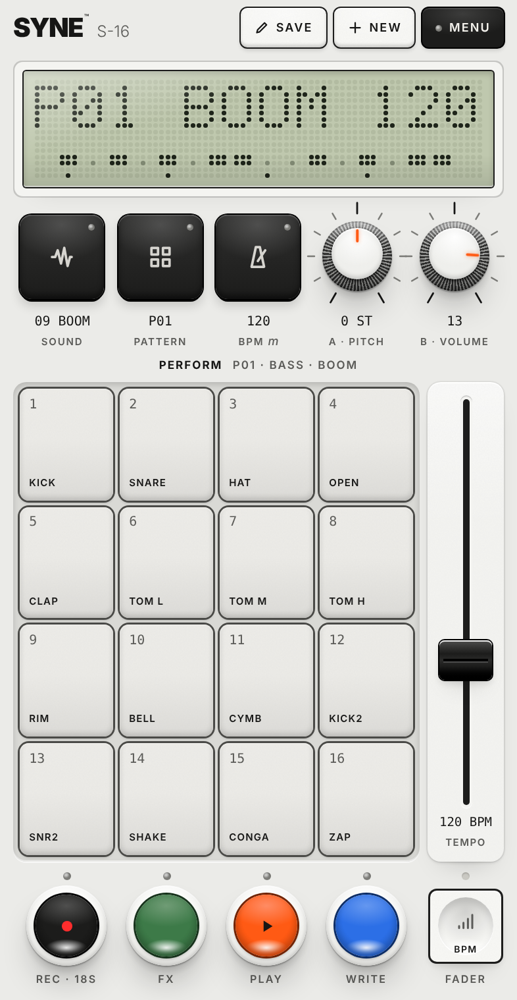

# SYNE S-16

A pocket sampler, drum machine and sequencer that runs in the browser. Record a sound with your phone's mic, play it across 16 pads, write patterns, chain them, and play them back with effects. It is built for a phone held in one hand, and it works on a laptop too.

**Open it:** the link to this site (GitHub Pages). On an iPhone, tap Share, then **Add to Home Screen**, and it opens full screen like an app. After the first visit it works offline.

## What's inside

- **16 sounds.** Slots 1–8 are melodic (the pads play a scale; 16 scales in the menu). Slots 9–16 are drum kits with 16 slices each. All 16 come with a factory sound, and you can replace any of them with your own recording.
- **Sampling.** Hold **RECORD** and a pad to record the mic into that slot. 40 seconds are shared across all slots. Tap RECORD twice to load an audio file.
- **16 patterns** of 16 steps. You can chain up to 128 patterns, or play several at once in pattern mode.
- **15 effects** to play live or record into a pattern: loops, stutter, octave, unison, scratch, 6/8, retrigger, reverse and more.
- **A fader with eight jobs:** tempo (50–250 BPM), swing, and the selected sound's low-pass, high-pass, band-pass, resonance, delay and reverb. Each sound keeps its own values.
- **Dials:** pitch and volume of the selected sound. Hold RECORD and they trim the start and length.

## Getting around

| Do this | And this happens |
| --- | --- |
| Pads | Play the selected sound |
| **SOUND** + pad | Pick a sound |
| **PATTERN** + pad (+ more pads) | Pick a pattern, or chain them in order |
| **PATTERN**, tapped | Pattern mode: turn several patterns on, pick the one to edit |
| **WRITE**, tapped | Step write: pads set the steps |
| Hold **WRITE** + pads, while playing | Live record |
| Hold **WRITE** + dials or fader, while playing | Lock a value to the current step |
| **FX** + pad | Effect while held. In write mode it is recorded; FX + 16 clears effects |
| **FADER** key | Step through the fader's jobs |
| **BPM** + pad | Master volume 1–16 |
| **RECORD** + **SOUND** / **PATTERN** | Delete the sound / clear the pattern |
| **WRITE** + **SOUND** + **PLAY** | Save a backup file of the whole project |
| **WRITE** + **SOUND** + **RECORD** | Load a backup file |

Hold any key on its own and its combinations appear over the display. The **MENU** has the full list, along with scales, engine settings, bounce-to-audio, undo and reset.

On a keyboard: `1234 qwer asdf zxcv` are the pads, and `g h j k l ;` and space are SOUND, PATTERN, BPM, FX, WRITE, RECORD and PLAY.

## Your data

Everything stays in your browser: sounds, patterns and settings are saved on your device, and nothing is uploaded. Clearing the site's data in the browser erases them, so keep a backup file of anything you care about. Recording asks for microphone permission the first time.

## Hosting

The whole app is one self-contained `index.html`. The other files make it installable and let it work offline: `manifest.webmanifest`, `sw.js` and the icons. Any static host works. On GitHub Pages: **Settings → Pages → Deploy from a branch → `main` / root**.
